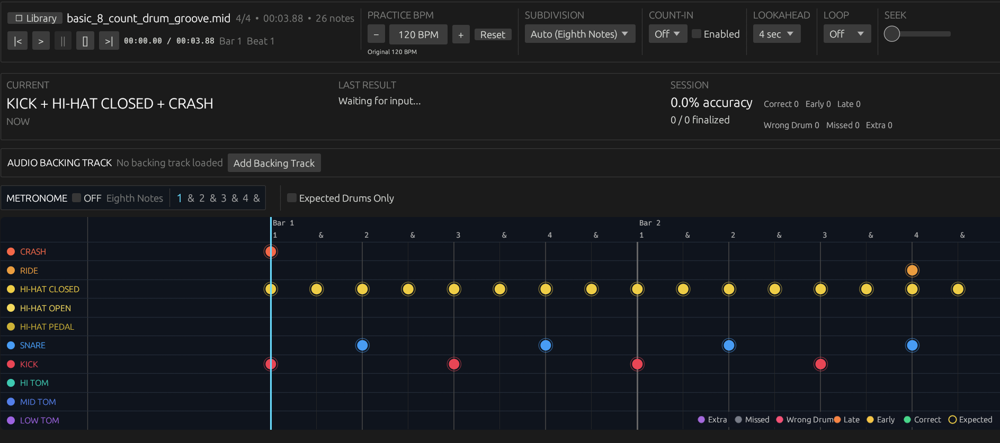
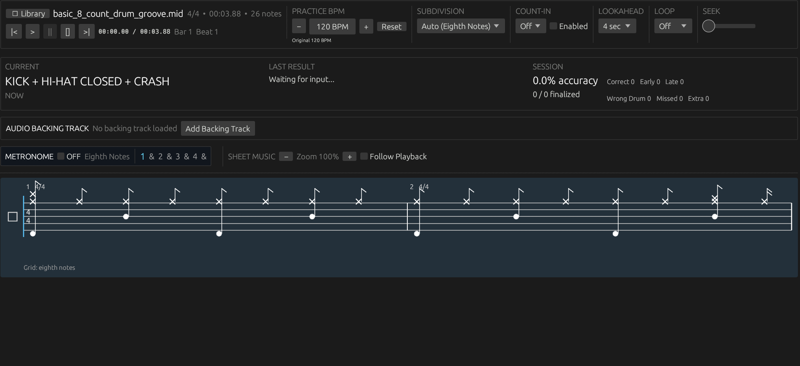

# MI Drums

MI Drums is a native desktop MIDI drum practice application for electronic drum kits. It turns Standard MIDI Files into playable exercises and provides real-time timing, accuracy, and performance feedback.

MI Drums runs locally and does not require a server or cloud account.





## Features

- MIDI device detection and live MIDI Monitor
- Guided Setup Wizard and Drum Mapping
- Multiple MIDI inputs per logical drum
- Closed/open hi-hat and pedal mapping
- MIDI Track Library and MIDI import
- Practice mode with tempo, count-in, loops, and lookahead
- Real-time Timeline and drum feedback
- Generated drum Sheet Music
- Metronome and selectable audio output
- Optional backing tracks
- Correct, Early, Late, Wrong Drum, Missed, and Extra feedback
- Session statistics, Performance Analysis, and Progress tracking
- Customizable theme, accent colour, and UI scale
- Reset All Data

## Requirements

- Windows x86_64 (currently tested platform)
- A MIDI-capable electronic drum kit for live practice
- An audio output device for metronome, test audio, and backing tracks
- Standard MIDI Files (`.mid` / `.midi`) for practice

## Download

Download the latest Windows release from the **Releases** page.

MI Drums is distributed as a portable ZIP. Extract it and run:

```text
MI-Drums.exe
